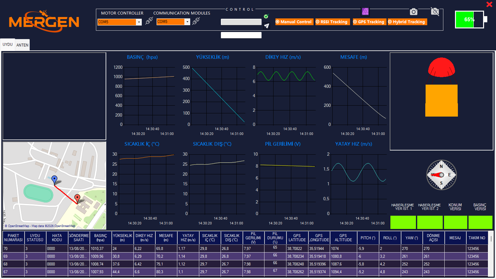
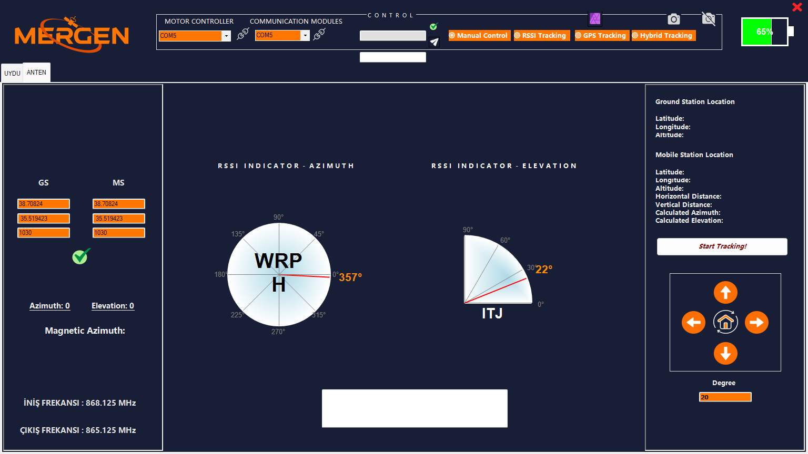

# MERGEN-KAT3-GCSS

MERGEN takımının model uydusu için yer istasyonu ve anten takip yazılımı. Uydudan gelen telemetriyi gösterir ve kaydeder. Uydunun ve yer istasyonunun GPS konumlarından anten açılarını hesaplar ve yer istasyonu antenini motorlarla uyduya çevirir. Uyduyla şifreli mesajlaşmayı ve uydudan gelen fotoğraf paketlerini alır.

C# ve Windows Forms (.NET Framework 4.7.2) ile yazılmıştır.

> **Güncel sürüm [`QR`](../../tree/QR) branch'indedir.** `master` branch'i projenin ilk arayüz tasarımını içerir. Aşağıdaki özellikler `QR` branch'indeki son sürümü anlatır.


*Uydu sekmesi: telemetri grafikleri, harita, 3B model, pusula ve tablo. Görüntülerdeki değerler örnek veridir.*


*Anten sekmesi: yer istasyonu ve uydu konumları, RSSI göstergeleri, takip ve elle kontrol.*

## Özellikler

- **İki seri port (9600 baud):**
  - Biri telemetri ve haberleşme, diğeri anten motor sürücüsü için.
  - Okuma ve işleme ayrı iş parçacıklarında çalışır.
  - Telemetri paketleri `$ ... #`, fotoğraf paketleri `< ... >` arasındadır. Bozuk paketler atılır.
- **Telemetri (25 alan):**
  - Paket numarası, uydu statüsü, hata kodu, gönderme saati.
  - Basınç, yükseklik, dikey ve yatay hız, mesafe.
  - İç ve dış sıcaklık, pil gerilimi ve pil yüzdesi.
  - Uydu GPS'i, pitch / roll / yaw, dönme açısı.
  - Mesaj, takım no, yer istasyonu GPS'i.
- **Grafikler, tablo ve kayıt:**
  - 8 zaman grafiği.
  - Her paket tabloya eklenir ve masaüstündeki `TELEMETRİ-KAT3.csv` dosyasına yazılır.
- **Harita:** GMap.NET + OpenStreetMap. Uydunun konumu ve izlediği yol çizilir.
- **3B simülasyon:** OpenTK ile uydu ve paraşüt modeli gelen açılarla döner.
- **Anten takibi:**
  - **Hesap:** iki GPS konumundan yatay ve dikey mesafe, azimut ve elevasyon hesaplanır (`AngleCalculator`).
  - **Otomatik takip:** "Start Tracking!" ile başlar; açılar her saniye `azimut,elevasyon` biçiminde motor sürücüsüne gönderilir.
  - **Elle kontrol:** yön düğmeleriyle azimut (0–360°) ve elevasyon (0–180°) adım adım değiştirilir, "home" komutuyla başlangıca dönülür.
  - **Takip modları:** arayüzde GPS, RSSI ve Hybrid takip seçenekleri bulunur.
- **Haberleşme:**
  - İki yer istasyonu modülü; çıkış frekansı 865,125 MHz, iniş frekansı 868,125 MHz.
  - Azimut ve elevasyon için RSSI göstergeleri.
- **Şifreli mesaj:** uyduya gönderilen mesaj AES ile şifrelenip `A,<hex>` biçiminde gönderilir; uydudan gelen şifreli mesaj çözülüp gösterilir.
- **Fotoğraf alma:** `<paket_no,hex_veri>` paketleri masaüstündeki `photo_data.txt` dosyasına eklenir.
- **ARAS (arıza tespit) göstergesi:** hata kodunun bitleri ışıklarla gösterilir.

## Telemetri biçimi

```
$paket*statü*hata_kodu*saat*basınç*yükseklik*dikey_hız*mesafe*yatay_hız*sıcaklık_iç*sıcaklık_dış*pil*pil_yüzde*
 gps1_enlem*gps1_boylam*gps1_yükseklik*pitch*roll*yaw*dönme_açısı*mesaj*takım_no*gps2_enlem*gps2_boylam*gps2_yükseklik#
```

`gps1` uydunun, `gps2` yer istasyonunun konumudur. Ondalık ayırıcı noktadır.

## Dosyalar

| Dosya | İçerik |
|---|---|
| `Form1.cs` | Ana pencere, portlar, takip ve elle kontrol düğmeleri, AES şifreleme |
| `Data.cs` | Seri port okuma, telemetri ve fotoğraf paketlerini ayırma, komut gönderme |
| `TelemetryData.cs` | Paket ayrıştırıcı |
| `AngleCalculator.cs` | GPS konumlarından azimut ve elevasyon hesabı |
| `AntennaController.cs` | Motor komutları, otomatik takip döngüsü |
| `Charts.cs`, `DataGridViewHandler.cs` | Grafikler, tablo ve CSV kaydı |
| `Map.cs`, `_3DSimulation.cs` | Harita ve 3B model |
| `Aras.cs` | Hata kodu göstergesi |
| `CompassControl.cs`, `CircularProgress.cs`, `QuarterCircularProgress.cs`, `BatteryProgressBar.cs` | Özel göstergeler |

## Kurulum ve çalıştırma

**Gerekenler:**
- Windows 10 / 11
- Visual Studio 2019 ya da 2022, ".NET masaüstü geliştirme" iş yüküyle (.NET Framework 4.7.2 dahil)
- Harita için internet bağlantısı

**Adımlar:**
1. Depoyu indirin ve istediğiniz sürümün branch'ine geçin:
   ```
   git clone https://github.com/SalihAlici/MERGEN-KAT3-GCSS.git
   cd MERGEN-KAT3-GCSS
   git checkout QR
   ```
2. `MERGEN-KAT3-GCSS.sln` dosyasını Visual Studio ile açın.
3. NuGet paketlerini geri yükleyin: Solution'a sağ tık → *Restore NuGet Packages*. Paketler ilk derlemede otomatik de inebilir.
4. Derleyip çalıştırın (F5).
5. *Communication Modules* kısmından haberleşme modülünün portunu, *Motor Controller* kısmından anten motor sürücüsünün portunu seçip bağlanın. Portlar 9600 baud ile açılır.
6. *ANTEN* sekmesinde yer istasyonu konumunu girin. Otomatik takip için *Start Tracking!*'e basın ya da yön düğmeleriyle anteni elle çevirin.

Telemetri kaydı masaüstündeki CSV dosyasına yazılır.

## Kullanılan kütüphaneler

GMap.NET (harita), OpenTK (3B), System.Windows.Forms.DataVisualization (grafikler), System.Security.Cryptography (AES).

## Geliştiren

[SalihAlici](https://github.com/SalihAlici)
